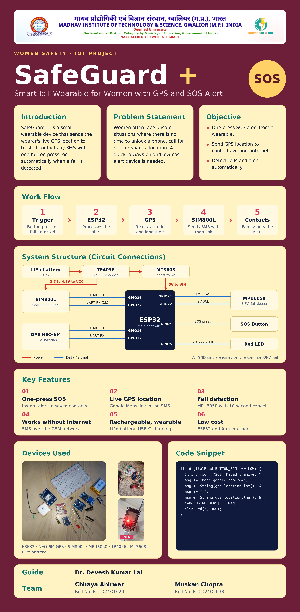
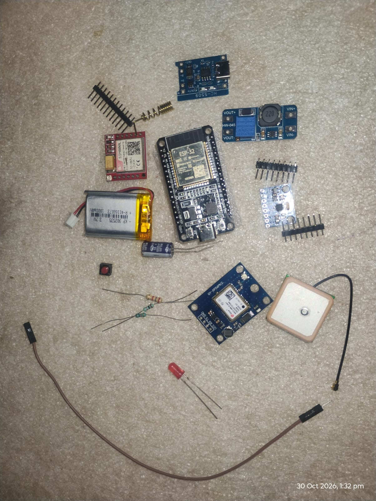
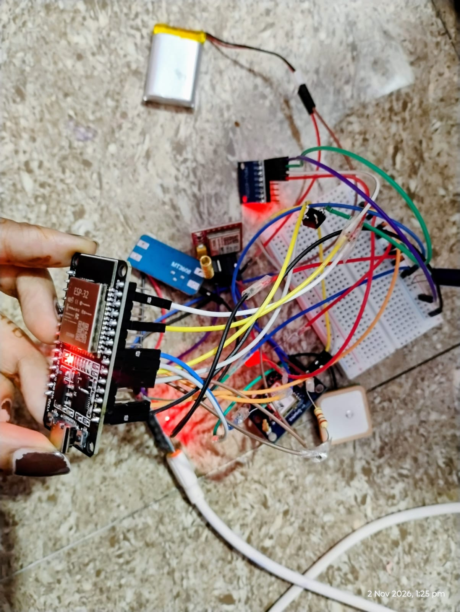
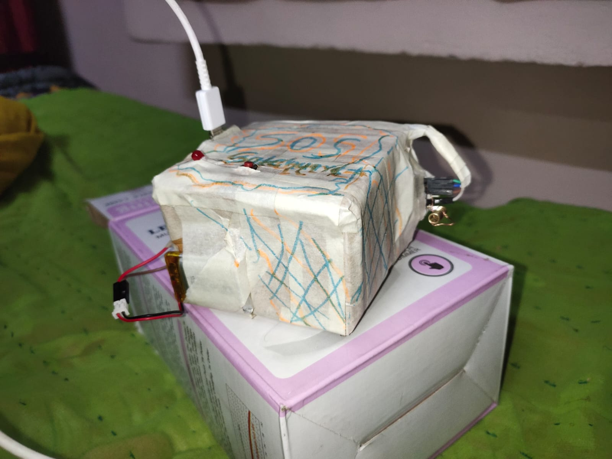

🛡️ SafeGuard+ – Smart IoT Wearable for Women's Safety

**A Standalone IoT-Based Women's Safety Wearable Using ESP32, GPS and GSM Technology**

📌 Project Overview

SafeGuard+ is a standalone IoT-based wearable safety device designed to provide emergency assistance through GPS tracking and GSM communication.

The system uses an ESP32 microcontroller integrated with a GPS module, GSM module, and motion sensor to provide emergency alerts and location tracking.

When the user presses the SOS button, the device sends an emergency SMS containing the user's current GPS location to registered emergency contacts and attempts to make emergency calls.

The system also includes geofencing functionality to detect movement beyond a predefined 5 km radius and experimental fall detection using an MPU6050 accelerometer and gyroscope.

🎯 Objectives
To develop a low-cost standalone wearable safety device.
To provide emergency alerts through SMS and calls.
To share real-time GPS location with registered emergency contacts.
To implement geofencing for location-based alerts.
To explore fall detection using the MPU6050 sensor.
To improve personal safety through embedded IoT technology.
✨ Key Features
SOS Emergency Alert: Sends an emergency SMS when the SOS button is pressed.
GPS Tracking: Retrieves the current geographical coordinates using the NEO-6M GPS module.
Location Sharing: Generates a Google Maps link and shares it through SMS.
Geofencing: Detects movement beyond a predefined 5 km radius.
Emergency Calling: Attempts to call configured emergency contacts.
Fall Detection: Uses the MPU6050 sensor for basic fall-event detection.
Standalone Operation: Works without requiring a smartphone application.
🛠️ Hardware & Prototype Overview
1. Components Overview

!SafeGuard+ Components Overview

Figure 1: Complete hardware breakdown including ESP32 development board, SIM800L GSM/GPRS module, NEO-6M GPS module, power management unit, and trigger switches.

2. Circuit Connections

!SafeGuard+ Circuit Diagram

Figure 2: Pin mapping and wiring connections between the ESP32 microcontroller, GPS module, GSM module, and power supply.

3. Hardware Assembly

!SafeGuard+ Hardware Assembly

Figure 3: Intermediate hardware integration showing compact module placement and wire routing prior to final enclosure.

4. Final Prototype

!SafeGuard+ Final Prototype

Figure 4: Fully assembled wearable SafeGuard+ device enclosed in a protective casing with accessible emergency alert controls.

🔩 Hardware Components
Component	Purpose
ESP32 Development Board	Main microcontroller
NEO-6M GPS Module	GPS location tracking
SIM800L GSM Module	SMS and emergency calls
MPU6050 Sensor	Fall detection
SOS Push Button	Manual emergency trigger
Li-Po Battery	Power supply
TP4056 Module	Battery charging
MT3608 Boost Converter	Voltage conversion
Jumper Wires	Circuit connections
Breadboard	Hardware prototyping
💻 Software & Technologies
Arduino IDE
Embedded C/C++
ESP32 Microcontroller
GPS Communication
GSM Communication
UART Communication
I2C Communication
TinyGPSPlus Library
⚙️ Working Principle
The ESP32 initializes the GPS, GSM, and MPU6050 modules.
The GPS module receives satellite signals and obtains the device's current location.
The first valid GPS location is stored as the geofence centre.
When the SOS button is pressed, the ESP32 generates an emergency alert.
An SMS containing the Google Maps location link is sent to registered emergency contacts.
The device attempts emergency calls to configured contacts.
If the device moves beyond the configured 5 km geofence radius, a location-based alert is triggered.
The MPU6050 continuously provides acceleration and gyroscope data for basic fall-event detection.
📂 Repository Structure
text
SafeGuard-Plus/
│
├── Code/
│   └── SafeGuard_Plus_Final.ino
│
├── Documentation/
│   ├── Project_Report.pdf
│   └── Research_Paper.pdf
│
├── Circuit_Diagram/
│   └── Circuit_Diagram.png
│
├── Images/
│   ├── SafeGuard_Banner.png
│   ├── Components.jpg
│   ├── Circuit_Connections.jpg
│   ├── Hardware_Assembly.jpg
│   └── Final_Prototype.jpg
│
├── Demo/
│   └── Demo_Link.txt
│
└── README.md

🚀 Setup & Installation
Prerequisites
Arduino IDE
ESP32 Board Package
TinyGPSPlus Library
Required hardware components
USB cable for programming
Installation Steps
Install the Arduino IDE.
Install the ESP32 board package through Boards Manager.
Install the TinyGPSPlus library through Library Manager.
Clone or download this repository.
Open Code/SafeGuard_Plus_Final.ino.
Configure the emergency contact numbers locally in the source code.
Connect all hardware components according to the circuit diagram.
Select the appropriate ESP32 board and COM port.
Upload the sketch to the ESP32.
Test GPS positioning, GSM communication, SOS alerts, geofencing, and fall detection.
🔔 Expected System Output
Emergency SMS with Google Maps location link.
Emergency call attempts to registered contacts.
Geofence-based location alerts.
Basic fall-event detection through MPU6050 sensor readings.
⚠️ Project Limitations
GPS positioning may be unavailable indoors or in areas with poor satellite reception.
GSM communication depends on compatible 2G network availability.
Fall detection is experimental and may generate false alerts.
Emergency SMS and calls depend on network coverage and stable module power.
The first valid GPS location may not always represent a safe or appropriate geofence centre.
🔮 Future Scope
Improved fall detection using sensor calibration and testing.
More reliable emergency alert confirmation.
Compact and comfortable wearable enclosure.
Improved battery backup and power management.
Integration with mobile applications.
Advanced location tracking and alert management.
📚 Project Information
Details	Description
Project Name	SafeGuard+
Domain	Internet of Things (IoT)
Platform	ESP32
Project Type	Standalone IoT Wearable Safety Device
Programming Language	Embedded C/C++
Communication	GPS and GSM
Development Environment	Arduino IDE
⚖️ Disclaimer

SafeGuard+ is an academic prototype developed for educational and research purposes.

It is not a replacement for verified emergency services or a guaranteed personal safety system. GPS accuracy, GSM network availability, battery performance, and sensor reliability may affect its operation.

Users should not depend exclusively on this prototype during emergencies.

👨‍💻 Project Repository

Explore the source code, hardware documentation, circuit diagrams, and prototype images in this repository.

SafeGuard+ – Smart IoT Wearable for Women's Safety

*Technology for a safer tomorrow.*

Arduino Code:
/*
  SafeGuard+ - Standalone IoT Safety Wearable
  Board: ESP32 Dev Module

  Libraries:
  1. TinyGPSPlus (install from Arduino Library Manager)
  2. Wire (built-in)

  Pin connections:
  SOS Button : GPIO 4  -> GND
  GPS TX     : GPIO 16 (ESP32 RX)
  GPS RX     : GPIO 17 (ESP32 TX) [optional]
  SIM800L TX : GPIO 26 (ESP32 RX)
  SIM800L RX : GPIO 27 (ESP32 TX) [level interface as required]
  MPU6050 SDA: GPIO 21
  MPU6050 SCL: GPIO 22
*/

#include <TinyGPSPlus.h>
#include <Wire.h>

// ---------- PIN CONFIGURATION ----------
#define SOS_BUTTON 4

#define GPS_RX 16
#define GPS_TX 17

#define GSM_RX 26
#define GSM_TX 27

#define MPU_ADDR 0x68

// ---------- EMERGENCY CONTACTS ----------
// Replace these with actual numbers, including country code.
const char* contacts[] = {
  "+918085338336",
  "+918719044274"
};

const int CONTACT_COUNT = 2;

// ---------- SETTINGS ----------
const float GEOFENCE_RADIUS = 5000.0;  // 5 km
const float FALL_THRESHOLD = 2.5;      // Experimental threshold in g

const unsigned long CALL_DURATION = 20000;
const unsigned long ALERT_COOLDOWN = 60000;

// ---------- OBJECTS ----------
TinyGPSPlus gps;

HardwareSerial gpsSerial(1);
HardwareSerial gsmSerial(2);

// ---------- VARIABLES ----------
double centreLat = 0;
double centreLon = 0;

bool geofenceReady = false;
bool outsideGeofence = false;

int outsideCount = 0;
int insideCount = 0;

bool previousButtonState = HIGH;

unsigned long lastFallAlert = 0;
unsigned long lastGeofenceAlert = 0;

unsigned long lastGPSPrint = 0;

// ---------- GPS LOCATION ----------
bool getValidLocation() {
  return gps.location.isValid() &&
         gps.location.age() < 3000 &&
         gps.hdop.isValid() &&
         gps.hdop.value() < 500;
}

String getMapsLink() {
  if (!getValidLocation()) {
    return "GPS location not available";
  }

  String link = "https://maps.google.com/?q=";
  link += String(gps.location.lat(), 6);
  link += ",";
  link += String(gps.location.lng(), 6);

  return link;
}

// ---------- GSM RESPONSE ----------
bool waitForGSM(const char* expected, unsigned long timeout) {
  String response = "";
  unsigned long start = millis();

  while (millis() - start < timeout) {
    while (gsmSerial.available()) {
      char c = gsmSerial.read();
      response += c;

      if (response.indexOf(expected) >= 0) {
        return true;
      }
    }
  }

  Serial.println(response);
  return false;
}

// ---------- SEND SMS ----------
bool sendSMS(const char* number, String message) {
  Serial.print("Sending SMS to ");
  Serial.println(number);

  gsmSerial.println("AT+CMGF=1");
  delay(500);

  gsmSerial.print("AT+CMGS=\"");
  gsmSerial.print(number);
  gsmSerial.println("\"");

  if (!waitForGSM(">", 5000)) {
    Serial.println("SMS prompt not received.");
    return false;
  }

  gsmSerial.print(message);
  gsmSerial.write(26);

  bool sent = waitForGSM("+CMGS:", 15000);

  if (sent) {
    Serial.println("SMS accepted by GSM module.");
  } else {
    Serial.println("SMS sending not confirmed.");
  }

  return sent;
}

// ---------- CALL CONTACT ----------
void callContact(const char* number) {
  Serial.print("Calling ");
  Serial.println(number);

  gsmSerial.print("ATD");
  gsmSerial.print(number);
  gsmSerial.println(";");

  delay(CALL_DURATION);

  gsmSerial.println("ATH");
  delay(1000);
}

// ---------- SEND ALERT ----------
void sendEmergencyAlert(String reason) {
  Serial.println("EMERGENCY ALERT!");

  String message = "SafeGuard+ ALERT: ";
  message += reason;
  message += "\nLocation: ";
  message += getMapsLink();

  // Send SMS to all contacts first
  for (int i = 0; i < CONTACT_COUNT; i++) {
    sendSMS(contacts[i], message);
    delay(1000);
  }

  // Call each contact for the configured duration
  for (int i = 0; i < CONTACT_COUNT; i++) {
    callContact(contacts[i]);
    delay(1000);
  }
}

// ---------- MPU6050 ----------
bool initialiseMPU() {
  Wire.beginTransmission(MPU_ADDR);
  Wire.write(0x6B);
  Wire.write(0x00);  // Wake up MPU6050

  return Wire.endTransmission() == 0;
}

bool readAcceleration(float &magnitude) {
  Wire.beginTransmission(MPU_ADDR);
  Wire.write(0x3B);
  if (Wire.endTransmission(false) != 0) {
    return false;
  }

  Wire.requestFrom(MPU_ADDR, 6);

  if (Wire.available() < 6) {
    return false;
  }

  int16_t ax = Wire.read() << 8 | Wire.read();
  int16_t ay = Wire.read() << 8 | Wire.read();
  int16_t az = Wire.read() << 8 | Wire.read();

  // Default MPU6050 accelerometer range: +/- 2g
  float x = ax / 16384.0;
  float y = ay / 16384.0;
  float z = az / 16384.0;

  magnitude = sqrt(x * x + y * y + z * z);

  return true;
}

// ---------- FALL DETECTION ----------
void checkFall() {
  float acceleration;

  if (!readAcceleration(acceleration)) {
    return;
  }

  if (acceleration > FALL_THRESHOLD &&
      millis() - lastFallAlert > ALERT_COOLDOWN) {

    Serial.println("Possible fall detected!");

    sendEmergencyAlert("Possible fall detected");

    lastFallAlert = millis();
  }
}

// ---------- DISTANCE ----------
double calculateDistance(double lat1, double lon1,
                         double lat2, double lon2) {
  return TinyGPSPlus::distanceBetween(
    lat1, lon1, lat2, lon2
  );
}

// ---------- GEOFENCING ----------
void checkGeofence() {
  if (!getValidLocation()) {
    return;
  }

  double currentLat = gps.location.lat();
  double currentLon = gps.location.lng();

  // First valid GPS fix becomes the centre
  if (!geofenceReady) {
    centreLat = currentLat;
    centreLon = currentLon;

    geofenceReady = true;

    Serial.println("Geofence centre saved.");
    Serial.print("Centre latitude: ");
    Serial.println(centreLat, 6);
    Serial.print("Centre longitude: ");
    Serial.println(centreLon, 6);

    return;
  }

  double distance = calculateDistance(
    centreLat, centreLon,
    currentLat, currentLon
  );

  Serial.print("Distance from centre: ");
  Serial.print(distance);
  Serial.println(" metres");

  if (distance > GEOFENCE_RADIUS) {
    outsideCount++;
    insideCount = 0;

    // Require 3 consecutive outside readings
    if (outsideCount >= 3 && !outsideGeofence) {
      outsideGeofence = true;

      if (millis() - lastGeofenceAlert > ALERT_COOLDOWN) {
        sendEmergencyAlert("Device moved outside 5 km geofence");
        lastGeofenceAlert = millis();
      }
    }
  } else {
    insideCount++;
    outsideCount = 0;

    // Re-arm after 3 consecutive inside readings
    if (insideCount >= 3) {
      outsideGeofence = false;
    }
  }
}

// ---------- SOS BUTTON ----------
void checkSOSButton() {
  bool currentState = digitalRead(SOS_BUTTON);

  if (previousButtonState == HIGH && currentState == LOW) {
    delay(40); // Basic debounce

    if (digitalRead(SOS_BUTTON) == LOW) {
      Serial.println("SOS BUTTON PRESSED!");

      sendEmergencyAlert("Manual SOS button pressed");
    }
  }

  previousButtonState = currentState;
}

// ---------- SETUP ----------
void setup() {
  Serial.begin(115200);

  pinMode(SOS_BUTTON, INPUT_PULLUP);

  gpsSerial.begin(9600, SERIAL_8N1, GPS_RX, GPS_TX);
  gsmSerial.begin(9600, SERIAL_8N1, GSM_RX, GSM_TX);

  Wire.begin(21, 22);

  Serial.println();
  Serial.println("SafeGuard+ Starting...");

  delay(3000);

  gsmSerial.println("AT");
  delay(1000);

  gsmSerial.println("ATE0");
  delay(500);

  gsmSerial.println("AT+CMGF=1");
  delay(500);

  if (initialiseMPU()) {
    Serial.println("MPU6050 detected.");
  } else {
    Serial.println("MPU6050 not detected. Check wiring.");
  }

  Serial.println("SafeGuard+ Ready.");
  Serial.println("Waiting for GPS fix...");
}

// ---------- MAIN LOOP ----------
void loop() {
  // Continuously read GPS data
  while (gpsSerial.available()) {
    gps.encode(gpsSerial.read());
  }

  checkSOSButton();

  if (getValidLocation()) {
    checkGeofence();
  }

  checkFall();

  if (millis() - lastGPSPrint > 5000) {
    lastGPSPrint = millis();

    if (getValidLocation()) {
      Serial.print("Latitude: ");
      Serial.println(gps.location.lat(), 6);

      Serial.print("Longitude: ");
      Serial.println(gps.location.lng(), 6);
    } else {
      Serial.println("Waiting for valid GPS location...");
    }
  }

  delay(20);
}
